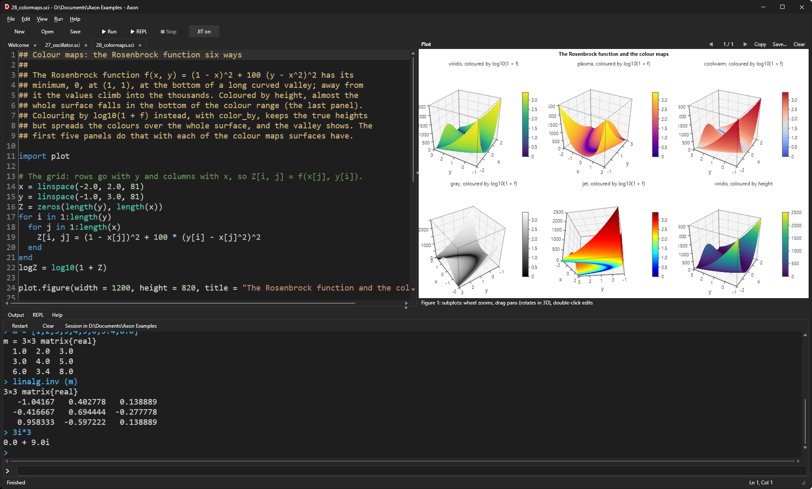

# Axon

*Axon was developed by Herbert Sauro in collaboration with [Claude Code](https://claude.com/claude-code), Anthropic's AI coding assistant.*

Axon is a programming language for scientific computing. Matrices, complex numbers and calls into native numerical libraries are part of the language rather than add-ons. The syntax borrows what scientists already read fluently (MATLAB-style matrix literals, 1-based indexing, `end`-delimited blocks) and adds a module system, records, keyword arguments and optional type annotations.

This repository holds the interpreter, written in Delphi, its standard library, and the Axon IDE.

```axon
import ode

# Linear algebra is built in: \ solves A x = b.
A = [4.0, 1.0; 1.0, 3.0]
b = [1.0; 2.0]
println(A \ b)

# Lotka-Volterra predator and prey, solved with RK45.
p = {a: 1.0, b: 0.1, c: 0.075, d: 1.5}
f = function(t, y)
  return [p.a*y[1] - p.b*y[1]*y[2]; p.c*y[1]*y[2] - p.d*y[2]]
end
sol = ode.solve(f, [10.0; 5.0], [0, 50])
println("steps:", sol.nsteps, "prey at t = 50:", format(sol.y[1, end], 2))
```

## The IDE



The Axon IDE runs programs and a REPL side by side with the editor. Figures appear in the plot pane, where 2D charts can be zoomed and panned and 3D charts turned with the mouse, and the Documentation tab holds the help pages, a tutorial for newcomers to programming, the Language Reference and the White Paper.

## Examples

**Reaction models.** The `antimony` module reads models written in [Antimony](https://tellurium.readthedocs.io/en/latest/antimony.html), simulates them, finds steady states (with conservation laws handled automatically) and does metabolic control analysis:

```axon
import antimony
import fmt
import plot

# A feedback-inhibited pathway, written in Antimony.
model = antimony.load("""
    J0: -> S1;      v0 / (1 + (S3/Ki)^h)
    J1: S1 -> S2;   Vm1*S1/(Km1 + S1)
    J2: S2 -> S3;   Vm2*S2/(Km2 + S2)
    J3: S3 -> ;     k3*S3
    v0 = 10; Ki = 1; h = 4; Vm1 = 12; Km1 = 2; Vm2 = 15; Km2 = 1.5; k3 = 2""")

# A time course, plotted.
sol = antimony.simulate(model, 10.0, points = 201)
names = antimony.species_names(model)
for i in 1:length(names)
  plot.line(sol.t, sol.y[i, :], label = names[i])
end
plot.xlabel("time")
plot.show()

# The steady state, and which steps control the flux through the pathway.
c = antimony.control(model)
println(fmt.matrix(c.y', cols = c.species, decimals = 3))
println(fmt.matrix(c.flux_control[1:1, :], rows = {"flux"}, cols = c.reactions, decimals = 2))
```

```
   S1     S2     S3
0.553  0.314  1.299
        J0    J1    J2    J3
flux  0.25  0.00  0.00  0.75
```

The model's rate laws become one function that the JIT compiles to native code, so even models with dozens of reactions simulate quickly.

**Plots, 2D and 3D.** `plot` draws line, scatter, bar and histogram charts, surfaces, 3D bars, curves and scatter plots, and saves them as PNG, SVG or PDF:

```axon
import plot

g = linspace(-2.0, 2.0, 40)
Z = zeros(40, 40)
for i in 1:40
  for j in 1:40
    Z[i, j] = exp(-(g[i]^2 + g[j]^2)) * cos(3 * g[j])
  end
end
plot.figure(title = "exp(-r^2) cos(3x)")
plot.surface(g, g, Z, colormap = "viridis")
plot.save("surface.pdf")        # or .png, .svg
plot.show()                     # in the IDE: drag to rotate
```

**Fast loops.** Functions are compiled to native code at their first call, so plain loops run at the speed of compiled code:

```axon
import time

## The sum of 1/k for k from 1 to n.
function harmonic(n)
  total = 0.0
  for k in 1:n
    total = total + 1 / k
  end
  return total
end

println(harmonic(10000000))
println("took", time.format(time.elapsed(harmonic, 10000000)))   # about 10 ms
```

**Drawing.** `draw` draws shapes, text, images, turtle graphics and L-systems on a canvas, in coordinates of your choosing:

```axon
import draw

draw.canvas(width = 400, height = 400, view = [-1, 1, -1, 1])
draw.style(color = "blue", width = 2)
for k in 1:12
  a = 2 * pi * k / 12
  draw.circle(0.5 * cos(a), 0.5 * sin(a), 0.4)
end
draw.circle(0, 0, 0.18, fill = "white", color = "none")
draw.text(0, 0, "Axon", size = 28, anchor = "middle", bold = true)
draw.show()
```

The [examples/](examples) folder has more, from the basics to ODEs with events, sparse matrices, random numbers, metabolic control analysis and animations; the IDE's Welcome tab lists them.

## Features

- **Numbers and arrays.** `int`, `real` and `complex` scalars; dense vectors and matrices with broadcasting, BLAS products and LAPACK-backed `\`, `/` and `^`; sparse matrices with a built-in sparse LU.
- **Language.** Functions with keyword arguments, closures, records, lists and dictionaries, `try`/`catch`, optional type annotations, and modules with explicit exports.
- **Standard library.** `linalg` (solve, eig, svd, qr, lu, chol, expm, ...), `ode` (RK45 and stiff BDF through SUNDIALS CVODE, with events and dense output), `nonlin` (nonlinear equations through SUNDIALS KINSOL), `antimony` (reaction models: simulation, steady states, conservation analysis and metabolic control analysis), `plot` (line, scatter, bar, histogram, surface, 3D bar, curve and scatter plots to PNG, SVG or PDF), `draw` (shapes, text, images, turtle graphics and L-systems), `colors`, `fmt`, `random`, `time` and `io`.
- **Speed.** A JIT compiler built on [MIR](https://github.com/vnmakarov/mir) compiles numeric functions to native code at their first call, often hundreds of times faster than interpreting them, with identical results. ODE stepping loops run natively.
- **Native code.** `extern` blocks call C libraries directly, including callbacks.
- **IDE.** An editor with syntax colouring and as-you-type checks, a REPL that can run whole files and keep their variables, a plot pane with interactive charts (zoom, pan, rotate, editing) for line, scatter, bar, histogram, surface and 3D curve plots, F1 help that shows the matching section of the Language Reference, a searchable documentation viewer, and light and dark themes.

## Platforms

- **Windows (x64):** the interpreter, the IDE and all native libraries.
- **macOS (Apple Silicon):** the IDE, with the interpreter inside its app bundle, deployed through RAD Studio's PAServer, with OpenBLAS, CVODE and the JIT.

## Building

Axon is built with Embarcadero RAD Studio 13 (Delphi, BDS 37.0).

- **In RAD Studio:** open `Axon.groupproj` and use **Build All**. It builds the interpreter (`axon.dproj`), whose post-build step copies the native libraries, `stdlib`, examples and help into `Win64\<Config>`, then the IDE (`ide\AxonIDE.dproj`) into the same folder.
- **From the command line:** `build.cmd` builds Win64 Debug, and `build.cmd Release` builds Release.
- **Tests:** `test.cmd` runs the test suite; `test.cmd -jit` runs it with the JIT off, on and forced.

The IDE uses four components of mine that live in their own repositories: the [RhoSkiaCodeEditor](https://github.com/hsauro/RhoSkiaCodeEditor) code editor, the [RhoMarkdownViewer](https://github.com/hsauro/RhoMarkdownViewer) markdown viewer, the [Plot2DComponent](https://github.com/hsauro/Plot2DComponent) interactive chart, and the [Rho3DPlotter](https://github.com/hsauro/Rho3DPlotter) interactive 3D chart. The IDE project finds their source through its unit search path, in a `RhodyComponents` folder next to the Axon folder, so clone them there under these names:

```
cd ..
git clone https://github.com/hsauro/RhoSkiaCodeEditor.git RhodyComponents/RhoEditor
git clone https://github.com/hsauro/RhoMarkdownViewer.git RhodyComponents/RhoMarkDownViewer
git clone https://github.com/hsauro/Plot2DComponent.git RhodyComponents/PlottingComponent
git clone https://github.com/hsauro/Rho3DPlotter.git RhodyComponents/Rho3DPlotter
```

The interpreter (`axon.dproj`) needs neither.

Prebuilt native libraries are in `lib/win64` and `lib/macos`; see [lib/README.md](lib/README.md) for where each came from and how to rebuild it. The macOS libraries are built on the Mac by scripts in `tools/`.

## Running

- `axon file.sci` runs a program; `axon` on its own starts the REPL, where `help name` shows documentation.
- `AxonIDE` opens the IDE. Its Welcome tab lists the examples in [examples/](examples), from basics to ODEs, linear algebra, sparse matrices, random numbers and plots.

## Documentation

- [Language Reference](doc/Axon-Language-Reference.md): the exact syntax and semantics.
- [White Paper](doc/Axon-White-Paper.md): the design rationale, with examples.
- [help/](help): the IDE's help pages, including getting started, a tour of the language, and a [tutorial](help/tutorial.md) for scientists new to programming.
- The user manual, `doc/manual/axon-manual.tex`, covers the language and the IDE with worked examples; `tools\build_manual.cmd` builds it as a PDF. `tools\build_tutorial.cmd` builds the tutorial as a PDF.

## Licence

Axon's own code and documentation are released under the [MIT licence](LICENSE). The prebuilt native libraries in `lib/` are third-party software under their own licences, listed in [lib/README.md](lib/README.md): OpenBLAS, SUNDIALS, Skia and MIR are BSD or MIT licensed, and the MinGW runtime DLLs are GPL with the GCC Runtime Library Exception.
